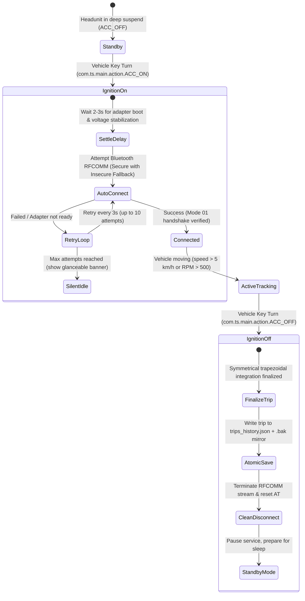

# Android Headunit Hardware & Deployment Specification
**Target Vehicle:** Suzuki Swift 3 (M15A Engine)  
**Target Hardware:** Topway TS18 (Chinese Automotive Android Headunit)

---

## 1. Hardware & System Context

| Attribute | Specification |
|---|---|
| **Headunit Chipset** | Topway TS18 (Allwinner / Unisoc SoC with custom MCU) |
| **Operating System** | Android 10/11/12 Automotive derivative with custom launcher |
| **OBD-II Hardware** | Bluetooth Classic ELM327 (paired in headunit BT app via PIN 1234/0000) |
| **Screen Resolution** | Widescreen Landscape (typically 1024x600 or 1280x720) |
| **Status Bar Mode** | System status bar retained (visible clock, volume, Wi-Fi/BT indicators) |

---

## 2. Background Architecture (Car Scanner Paradigm)

Chinese headunits (Topway TS18, FYT, Allwinner) run stripped Android ROMs where standard Google Settings menus (like "Special App Access -> Battery Optimization" or "Display over other apps") are absent. Attempting to request these permissions via standard Android dialogs fails silently without user feedback.

Following the proven architecture of **Car Scanner ELM OBD2**:

1. **Self-Contained Foreground Service:**
   - ReDrive operates via an Android `ForegroundService` with `startForeground()` and an ongoing status notification.
   - The Android Low Memory Killer (LMK) prioritizes foreground services identically to visible apps.
   - Android Doze mode does not throttle active foreground services.
   - **Zero special permissions required:** ReDrive does not ask for or require `REQUEST_IGNORE_BATTERY_OPTIMIZATIONS` or `SYSTEM_ALERT_WINDOW`.
2. **Insecure RFCOMM Bluetooth Fallback:**
   - On Chinese headunits, Bluetooth pairing is managed directly by the MCU. When an app initiates a standard secure RFCOMM socket (`createRfcommSocketToServiceRecord`), the Android Bluetooth stack often hangs or fails with an authentication error because the headunit lacks standard PIN dialogs.
   - ReDrive implements an automatic fallback to **Insecure RFCOMM** (`createInsecureRfcommSocketToServiceRecord`), allowing immediate socket communication with already-paired ELM327 adapters without hangs.
3. **Partial CPU Wakelock:**
   - While telemetry is active, a `PowerManager.PARTIAL_WAKE_LOCK` is held so CPU polling does not throttle if the headunit screen dims or enters screensaver mode.

---

## 3. Power Lifecycle & Ignition Handling

### Ignition ON (`ACC_ON`) Implementation
- **Screen Visibility:** Start strictly in the background as an Android foreground service. Do **not** forcibly pop `MainActivity` over the default car launcher, radio, or navigation apps.
- **Connection Timing:**
  - Introduce an initial 2.5-second stabilization delay after `ACC_ON` to accommodate vehicle cranking voltage dips and adapter boot times.
  - Silent auto-connect retry loop: 10 attempts spaced 3.0 seconds apart.
  - Display non-intrusive status banner in the dashboard (if opened) without blocking dialogs.

### Ignition OFF (`ACC_OFF`) Implementation
- Catch broadcast actions: `com.ts.main.action.ACC_OFF`, `com.topway.action.ACC_OFF`, `com.android.boot.action.ACC_OFF`, `Intent.ACTION_POWER_DISCONNECTED`.
- Gracefully trigger `tripProvider.stopTrip(forced: true)`.
- Atomically persist completed trip history to disk.
- Cleanly close `BluetoothConnection` to prevent hung RFCOMM channels on the MCU.

---

## 4. Background Service & Driver Alerts

### Notification Design
- **Type:** Status-only persistent foreground notification (`Importance.low`).
- **Goal:** Zero audio/UI stutter on low-power Chinese headunit CPU cores (no continuous 1Hz notification updates).
- **Titles & Content:**
  - Connected: `"ReDrive Connected | Monitoring active"`
  - Searching/Retrying: `"ReDrive Reconnecting | Attempt 3 of 10..."`
  - Idle/Disconnected: `"ReDrive Disconnected | Waiting for ignition"`

### Critical Safety Alert: Coolant Over-Temperature
- **Trigger:** Engine coolant temperature exceeding **102°C** (`0105 > 102`).
- **Notification:** High-importance heads-up banner with alert sound and red telemetry card indicator.
- **Hysteresis:** Alert resets only when coolant drops back below **96°C** to prevent repetitive sound chimes during traffic.
- All other notifications remain completely silent while in the background.

---

## 5. In-App Diagnostic Tooling

### "Test OBD Adapter" Tool in Settings
Add an interactive diagnostic tool accessible via **Settings → Connection Troubleshooting**:
- **One-Tap Diagnostic Flow:**
  1. Opens connection to the selected Bluetooth adapter (testing secure and insecure RFCOMM).
  2. Sends `ATZ` (reads ELM327 firmware identification, e.g. `ELM327 v2.3`).
  3. Sends `ATE0` (disables echo).
  4. Sends `ATDP` / `ATDPN` (reads active protocol, e.g. `ISO 14230-4 KWP FAST` or `CAN`).
  5. Sends `0100` (supported PIDs discovery query).
  6. Sends `010C` (reads live engine RPM).
- **Live Output Display:** High-contrast terminal output showing exact query-response pairs and diagnostic latency in milliseconds.
- **Adapter Verification Badge:** Clear visual indicator:
  - 🟢 **Genuine/Functional Adapter:** Valid protocol response and PID support.
  - 🟡 **Partial Clone:** Missing extended commands but basic telemetry working.
  - 🔴 **Failed Handshake:** Timeout or invalid string (`?`, `UNABLE TO CONNECT`).

---

## 6. APK Packaging & Deployment

- **Build Target:** Universal Release APK (`build/app/outputs/flutter-apk/app-release.apk`).
- **Architectures Included:** `armeabi-v7a` (32-bit ARM) and `arm64-v8a` (64-bit ARM) in a single fat binary to ensure 100% compatibility with TS18 knockoff firmware.
- **Signing:** Release build signed with standard development keystore for seamless sideloading.
- **Installation Flow:**
  1. Build via CLI: `flutter build apk --release`
  2. Copy `app-release.apk` to USB flash drive root.
  3. Insert USB into car headunit rear/front USB port.
  4. Open headunit "File Manager" or "ApkInstaller" app and tap Install.
